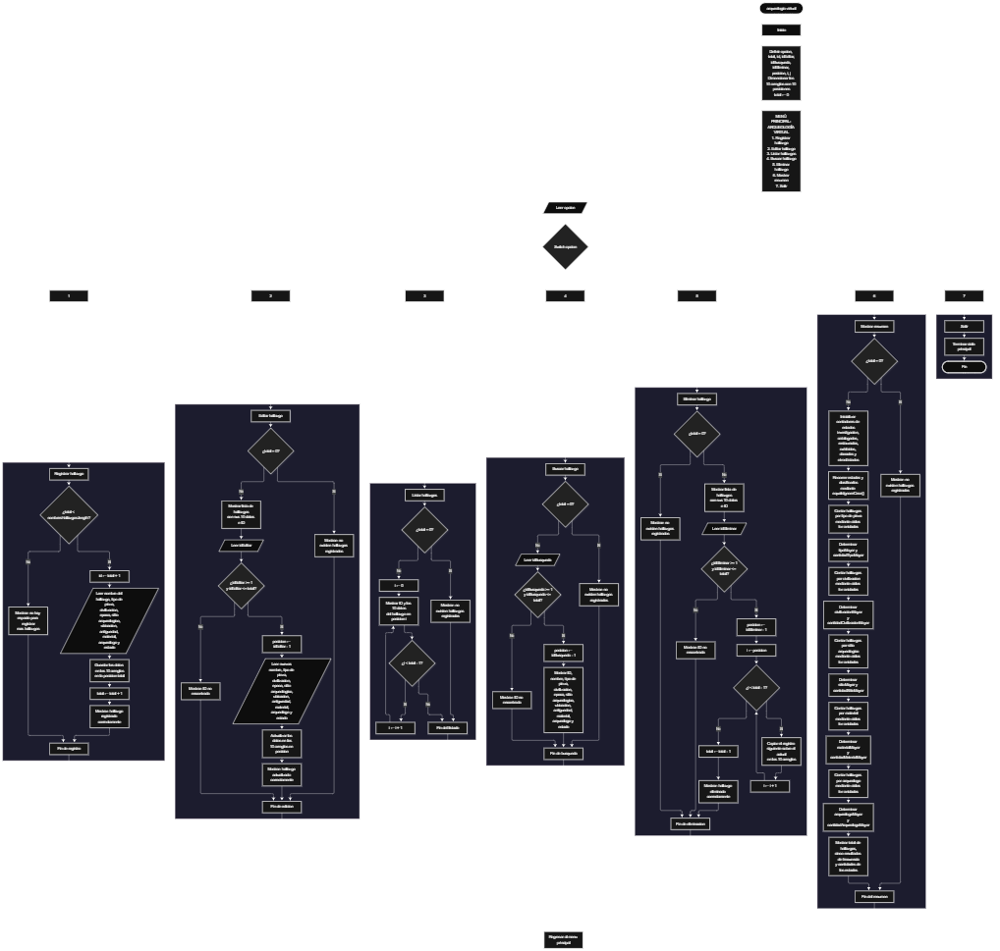

Este proyecto, llamado <b>arqueología virtual</b>, fue desarrollado en <b>java</b> como un ejercicio práctico para fortalecer la lógica de programación mediante la creación de un sistema de gestión de hallazgos arqueológicos desde la consola. El programa cuenta con un menú principal de siete opciones que permite <b>registrar, editar, listar, buscar, eliminar y consultar un resumen estadístico</b> de los hallazgos registrados. Cada hallazgo almacena información como el nombre, el tipo de pieza, la civilización, la época, el sitio arqueológico, la ubicación, la antigüedad aproximada, el material, el arqueólogo responsable y el estado actual, utilizando diez arreglos paralelos con una capacidad máxima de <b>10 hallazgos durante la ejecución</b>. Durante su desarrollo se aplicaron conceptos fundamentales de programación, como variables, arreglos, estructuras condicionales, ciclos repetitivos y estructuras de selección, además de procesos para buscar, modificar, eliminar y organizar registros, así como realizar análisis de frecuencia y clasificación de estados. Este proyecto permite poner en práctica los conocimientos adquiridos en java y sirve como base para desarrollar sistemas de gestión más avanzados utilizando otros lenguajes y tecnologías.

<h2 align="center">⚙️ Funcionamiento del menú principal</h2>

### ➕ Registrar hallazgo

La opción <b>1) registrar hallazgo</b> permite almacenar un nuevo hallazgo arqueológico en el sistema. Antes de realizar el registro, el programa comprueba que la cantidad de hallazgos almacenados sea menor que la capacidad del arreglo <b>nombresHallazgos</b>, utilizando la condición <b>total &gt;= nombresHallazgos.length</b> para identificar si no existe espacio disponible. Si se alcanza la capacidad máxima, muestra el mensaje <b>"no hay espacio para registrar más hallazgos."</b>, impidiendo agregar otro registro. Si existe espacio disponible, genera un identificador mediante la variable <b>id</b>, utilizando la expresión <b>total + 1</b>. Después, solicita el <b>nombre del hallazgo, tipo de pieza, civilización, época, sitio arqueológico, ubicación, antigüedad aproximada, material, nombre del arqueólogo y estado del hallazgo</b>. Los datos se almacenan en la posición correspondiente de sus respectivos arreglos. Finalmente, muestra el mensaje <b>"hallazgo registrado correctamente."</b> e incrementa la variable <b>total</b> en uno para actualizar la cantidad de registros almacenados.

### ✏️ Editar hallazgo

La opción <b>2) editar hallazgo</b> permite modificar la información de un hallazgo registrado. Primero, el programa comprueba si existen hallazgos almacenados mediante la condición <b>total == 0</b>. Si no hay registros, muestra el mensaje <b>"no existen hallazgos registrados."</b>. En caso contrario, presenta una lista con el ID, nombre, tipo de pieza, civilización, época, sitio arqueológico, ubicación, antigüedad, material, arqueólogo y estado de cada hallazgo. Después, solicita el ID del registro que se desea editar y comprueba que esté dentro del rango permitido mediante la condición <b>idEditar &gt;= 1 &amp;&amp; idEditar &lt;= total</b>. Si la selección es válida, obtiene la posición correspondiente mediante la expresión <b>idEditar - 1</b> y solicita los nuevos datos del hallazgo. La información anterior se reemplaza directamente en los diez arreglos correspondientes. Finalmente, muestra el mensaje <b>"hallazgo actualizado correctamente."</b>. Si el ID seleccionado no corresponde a un hallazgo registrado, presenta el mensaje <b>"ID no encontrada."</b>.

### 📋 Listar hallazgos

La opción <b>3) listar hallazgos</b> permite visualizar todos los hallazgos arqueológicos registrados actualmente en el sistema. Antes de mostrar la información, el programa comprueba si la variable <b>total</b> es igual a cero. Si no existen registros, presenta el mensaje <b>"no existen hallazgos registrados."</b>. Si hay hallazgos disponibles, muestra el título <b>"lista de hallazgos arqueológicos"</b> y utiliza un ciclo <b>for</b> para recorrer los arreglos desde la primera posición hasta la cantidad total de registros almacenados. Durante el recorrido, presenta el ID y los diez datos correspondientes a cada hallazgo. Esta función facilita consultar toda la información almacenada sin necesidad de buscar cada registro individualmente.

### 🔎 Buscar hallazgo

La opción <b>4) buscar hallazgo</b> permite localizar un registro mediante su identificador. Primero, el programa comprueba si existen hallazgos registrados. Si el valor de <b>total</b> es igual a cero, muestra el mensaje <b>"no existen hallazgos registrados."</b> e interrumpe la operación. En caso contrario, solicita el ID del hallazgo que se desea buscar y comprueba que esté comprendido entre <b>1</b> y el valor de <b>total</b>. Si el identificador es válido, obtiene la posición correspondiente mediante la expresión <b>idBusqueda - 1</b> y muestra toda la información del hallazgo encontrado: nombre, tipo de pieza, civilización, época, sitio arqueológico, ubicación, antigüedad, material, arqueólogo y estado. Si el ID introducido no corresponde a un registro existente, presenta el mensaje <b>"ID no encontrada."</b>. La búsqueda se realiza directamente mediante la posición asociada al identificador, sin recorrer los registros para comparar sus datos.

### 🗑️ Eliminar hallazgo

La opción <b>5) eliminar hallazgo</b> permite eliminar un registro mediante su ID dentro de la lista de hallazgos. Antes de comenzar, el programa comprueba que existan hallazgos almacenados. Si el sistema está vacío, muestra el mensaje <b>"no existen hallazgos registrados."</b>. Si hay registros disponibles, presenta una lista con la información de todos los hallazgos. Después, solicita el ID del registro que se desea eliminar y verifica que esté dentro del rango válido mediante la condición <b>idEliminar &gt;= 1 &amp;&amp; idEliminar &lt;= total</b>. Si el identificador es correcto, obtiene la posición mediante la expresión <b>idEliminar - 1</b>. Para mantener los registros organizados, utiliza un ciclo <b>for</b> que desplaza una posición hacia la izquierda los datos de los hallazgos posteriores en los diez arreglos: <b>nombresHallazgos, tiposPiezas, civilizaciones, epocas, sitiosArqueologicos, ubicaciones, antiguedades, materiales, arqueologos y estados</b>. Posteriormente, disminuye la variable <b>total</b> en uno y muestra el mensaje <b>"hallazgo eliminado correctamente."</b>. Si el ID seleccionado no corresponde a un hallazgo registrado, presenta el mensaje <b>"ID no encontrada."</b>.

### 📊 Mostrar resumen

La opción <b>6) mostrar resumen</b> permite consultar estadísticas generales de los hallazgos arqueológicos registrados. Primero, el programa comprueba si existen registros almacenados. Si la variable <b>total</b> es igual a cero, muestra el mensaje <b>"no existen hallazgos registrados."</b>. En caso contrario, inicializa seis contadores para clasificar los registros según su estado: <b>investigación, catalogados, restaurados, exhibidos, dañados y otros estados</b>. Mediante un ciclo <b>for</b> y estructuras condicionales, recorre el arreglo <b>estados</b> y compara cada valor utilizando el método <b>equalsIgnoreCase()</b>. Después, realiza cinco análisis de frecuencia utilizando ciclos <b>for</b> anidados, con el propósito de identificar el <b>tipo de pieza más frecuente, la civilización con más hallazgos, el sitio arqueológico con más descubrimientos, el material más utilizado y el arqueólogo con más descubrimientos</b>. Para determinar estos resultados, compara los valores almacenados en los arreglos correspondientes y contabiliza cuántas veces aparece cada uno. Finalmente, presenta el resumen de arqueología virtual, incluyendo la cantidad total de hallazgos, los cinco resultados estadísticos y los contadores de los diferentes estados. Cuando existen valores con la misma frecuencia máxima, se conserva el primero que alcanza dicha cantidad.

### 🚪 Salir del menú principal

La opción <b>7) salir</b> está destinada a finalizar la ejecución del programa y muestra el mensaje <b>"gracias por utilizar arqueología virtual."</b>. El menú principal se encuentra dentro de una estructura repetitiva <b>do-while</b>, que mantiene el programa en funcionamiento mientras el usuario realiza las operaciones disponibles. La condición de salida es <b>opcion != 7</b>, por lo que al seleccionar la opción 7 el ciclo termina y el programa ejecuta la instrucción <b>entrada.close()</b> para cerrar el objeto <b>Scanner</b>.

<h2 align="center">🧠 Temas aplicados en el proyecto</h2>

### 📦 Variables

En este proyecto se utilizan variables para controlar la cantidad de hallazgos registrados, almacenar la opción seleccionada en el menú, generar identificadores, seleccionar las posiciones de los registros que se desean editar, buscar o eliminar y realizar los diferentes análisis estadísticos. Cada variable cumple una función específica dentro de las operaciones de gestión y consulta de información arqueológica.

🔢 **Opcion:** Almacena la opción seleccionada por el usuario en el menú principal.

📊 **Total:** Almacena la cantidad actual de hallazgos registrados.

🆔 **Id:** Almacena el identificador generado para el nuevo hallazgo mediante la expresión `total + 1`.

✏️ **IdEditar:** Almacena el identificador del hallazgo que se desea modificar.

🔎 **IdBusqueda:** Almacena el identificador del hallazgo que se desea consultar.

🗑️ **IdEliminar:** Almacena el identificador del hallazgo que se desea eliminar.

📍 **Posicion:** Permite obtener el índice del arreglo correspondiente al ID seleccionado.

🔄 **I y J:** Funcionan como contadores en los ciclos utilizados para recorrer los registros y realizar los análisis de frecuencia.

📊 **CantidadTipo, CantidadCivilizacion, CantidadSitio, CantidadMaterial y CantidadArqueologo:** Almacenan las cantidades de coincidencias encontradas durante los análisis de frecuencia.

📈 **CantidadTipoMayor, CantidadCivilizacionMayor, CantidadSitioMayor, CantidadMaterialMayor y CantidadArqueologoMayor:** Almacenan las mayores frecuencias encontradas para cada categoría analizada.

📋 **Investigacion, Catalogados, Restaurados, Exhibidos, Danados y OtrosEstados:** Almacenan las cantidades de hallazgos clasificados según su estado.

🏺 **TipoMayor, CivilizacionMayor, SitioMayor, MaterialMayor y ArqueologoMayor:** Almacenan los valores que presentan la mayor frecuencia en sus respectivos análisis.

### 🗃️ Arreglos

En este proyecto se utilizan diez arreglos paralelos relacionados con los datos de cada hallazgo arqueológico. Cada arreglo tiene una capacidad de <b>10 posiciones</b> y utiliza el mismo índice para representar la información correspondiente a un mismo registro. Por ejemplo, los datos de un hallazgo almacenado en la posición <b>0</b> se encuentran distribuidos entre <b>nombresHallazgos[0], tiposPiezas[0], civilizaciones[0], epocas[0], sitiosArqueologicos[0], ubicaciones[0], antiguedades[0], materiales[0], arqueologos[0] y estados[0]</b>. Esta organización permite recorrer, buscar, modificar, mostrar, eliminar y analizar los hallazgos de manera ordenada.

🏺 **NombresHallazgos[10]:** Almacena los nombres de los hallazgos arqueológicos registrados.

🧩 **TiposPiezas[10]:** Almacena los tipos de piezas arqueológicas encontradas.

🏛️ **Civilizaciones[10]:** Almacena las civilizaciones a las que pertenecen los hallazgos.

📜 **Epocas[10]:** Almacena las épocas históricas correspondientes a cada hallazgo.

📍 **SitiosArqueologicos[10]:** Almacena los sitios arqueológicos donde se realizaron los descubrimientos.

🗺️ **Ubicaciones[10]:** Almacena las ubicaciones de los hallazgos registrados.

⏳ **Antiguedades[10]:** Almacena las antigüedades aproximadas de las piezas arqueológicas.

🪨 **Materiales[10]:** Almacena los materiales de los que están compuestas las piezas.

👨‍🔬 **Arqueologos[10]:** Almacena los nombres de los arqueólogos responsables de los hallazgos.

📋 **Estados[10]:** Almacena los estados actuales de los hallazgos arqueológicos.

### 🔀 Estructuras condicionales

En este proyecto se utilizan las estructuras <b>if</b>, <b>else if</b> y <b>else</b> para comprobar diferentes condiciones durante la ejecución del programa. Estas estructuras permiten verificar si existe espacio disponible antes de registrar un nuevo hallazgo, comprobar si hay registros almacenados antes de realizar determinadas operaciones, validar los identificadores seleccionados para editar, buscar o eliminar información y clasificar los hallazgos según su estado. También se utilizan para determinar si las frecuencias encontradas superan los valores máximos almacenados durante los análisis estadísticos. Estas condiciones permiten que el programa responda de manera diferente según la información disponible y los resultados de cada operación.

### 🔄 Estructuras repetitivas

En este proyecto se utilizan los ciclos <b>do-while</b> y <b>for</b> para controlar y realizar diferentes operaciones. El ciclo <b>do-while</b> mantiene activo el menú principal y permite ejecutar las opciones disponibles hasta que el usuario selecciona la opción 7. Los ciclos <b>for</b> permiten recorrer los arreglos para mostrar los hallazgos, presentar los registros antes de editarlos o eliminarlos y acceder a sus datos. Durante la eliminación, también se utilizan para desplazar los registros posteriores una posición hacia la izquierda. Por otro lado, los ciclos <b>for</b> anidados permiten comparar los valores almacenados en los arreglos y calcular las frecuencias de tipos de piezas, civilizaciones, sitios arqueológicos, materiales y arqueólogos.

### 🎯 Estructura switch

El programa utiliza la estructura <b>switch</b> para evaluar el valor almacenado en la variable <b>opcion</b> y ejecutar el bloque de instrucciones correspondiente. Cada caso representa una operación específica del sistema: <b>registrar, editar, listar, buscar, eliminar, mostrar resumen o salir</b>. También se utiliza el bloque <b>default</b> para mostrar el mensaje <b>"opcion no valida."</b> cuando el usuario introduce un número que no coincide con ninguna de las opciones definidas en el menú principal.

### 🔢 Dimensionamiento de arreglos

El programa utiliza la creación de arreglos mediante la instrucción <b>new String[10]</b> para establecer la capacidad de almacenamiento de los datos arqueológicos. Se definieron <b>10 posiciones</b> para cada uno de los diez arreglos, lo que permite administrar hasta diez hallazgos durante la ejecución. La cantidad de posiciones ocupadas se controla mediante la variable <b>total</b>, por lo que las operaciones recorren únicamente los registros comprendidos entre la primera posición y el total actual de hallazgos.

### 🔄 Reorganización de registros

Cuando se selecciona un hallazgo para eliminarlo, el programa utiliza un ciclo <b>for</b> que comienza en la posición seleccionada y llega hasta <b>total - 1</b>. En cada repetición, los datos de la posición siguiente se copian sobre la posición actual en los diez arreglos: <b>nombresHallazgos, tiposPiezas, civilizaciones, epocas, sitiosArqueologicos, ubicaciones, antiguedades, materiales, arqueologos y estados</b>. Después, la variable <b>total</b> disminuye en uno. De esta manera, los hallazgos posteriores ocupan las posiciones disponibles sin dejar espacios vacíos entre los registros activos. La última posición no se limpia explícitamente, pero deja de formar parte de los registros activos porque el contador se reduce.

<h2 align="center">¿Cómo se implementaron las operaciones crud en el proyecto?</h2>

Las operaciones <b>crud</b> se implementaron mediante las opciones del menú principal, permitiendo administrar los hallazgos arqueológicos registrados. La operación <b>crear</b> corresponde a <b>registrar hallazgo</b>, donde se introducen los datos de una nueva pieza arqueológica; <b>leer</b> se realiza mediante las opciones <b>buscar hallazgo y listar hallazgos</b>, que permiten consultar la información almacenada; <b>actualizar</b> corresponde a <b>editar hallazgo</b>, donde se modifican los datos de un registro existente; y <b>eliminar</b> se realiza mediante la opción <b>eliminar hallazgo</b>, que reorganiza los datos de los arreglos después de quitar un registro. Estas operaciones utilizan variables, arreglos, estructuras condicionales y ciclos para gestionar la información almacenada temporalmente durante la ejecución del programa. Adicionalmente, la opción <b>mostrar resumen</b> permite analizar estadísticamente los hallazgos registrados.

<h2 align="center">Diagrama de flujo del proyecto</h2>

<h2 align="center">🛡️ Validaciones del programa</h2>

### 📭 No existen hallazgos registrados

Esta validación se utiliza en las opciones de <b>editar, listar, buscar, eliminar y mostrar resumen</b>. El programa comprueba si la variable <b>total</b> es igual a <b>0</b> y, si no existen hallazgos registrados, muestra el mensaje <b>"no existen hallazgos registrados."</b>. Esta comprobación evita continuar con las operaciones que necesitan información almacenada cuando el sistema está vacío.

### ⚠️ Capacidad máxima alcanzada

Esta validación se utiliza durante el registro de nuevos hallazgos para controlar la capacidad máxima de los arreglos. El programa comprueba si <b>total &gt;= nombresHallazgos.length</b> antes de permitir agregar un nuevo registro. Si existe espacio disponible, solicita los diez datos del hallazgo y aumenta el contador <b>total</b> en uno. En caso contrario, muestra el mensaje <b>"no hay espacio para registrar más hallazgos."</b>, impidiendo registrar otro hallazgo mientras se mantenga la capacidad máxima.

### ❌ ID no encontrada

Esta validación se utiliza durante las operaciones de <b>editar, buscar y eliminar hallazgos</b>. El programa comprueba que el identificador introducido se encuentre dentro del rango comprendido entre <b>1</b> y <b>total</b>. Si el ID es válido, obtiene la posición correspondiente restando una unidad al identificador. Si el número introducido no corresponde a un hallazgo registrado, muestra el mensaje <b>"ID no encontrada."</b>. Esta comprobación evita acceder a posiciones que no corresponden a registros activos.

### 📋 Clasificación de estados

Esta comprobación se utiliza en la opción <b>mostrar resumen</b> para clasificar los hallazgos según su estado actual. El programa compara los valores del arreglo <b>estados</b> utilizando el método <b>equalsIgnoreCase()</b>. Los estados reconocidos son <b>"En investigacion"</b>, <b>"Catalogado"</b>, <b>"Restaurado"</b>, <b>"Exhibido"</b> y <b>"Dañado"</b>. Cuando un registro no coincide con ninguna de estas categorías, se contabiliza dentro de la variable <b>otrosEstados</b>. De esta manera, todos los registros se incluyen en el resumen estadístico.

### ⚠️ Opción inválida

La estructura <b>switch</b> incluye el bloque <b>default</b>, que muestra el mensaje <b>"opcion no valida."</b> cuando el usuario introduce un número que no corresponde a ninguna de las siete opciones definidas en el menú principal. Esta comprobación permite informar al usuario cuando selecciona una opción que no está disponible.

<h2 align="center">🎯 Objetivo del proyecto</h2>

El objetivo principal de este proyecto es fortalecer la <b>lógica de programación</b> mediante el desarrollo de un sistema de gestión de hallazgos arqueológicos en <b>java</b>. A través de su construcción se busca aplicar los conocimientos adquiridos sobre variables, arreglos, estructuras condicionales, ciclos repetitivos y estructuras de selección, integrándolos para resolver un problema de manera organizada. Además, el proyecto permite comprender cómo registrar, consultar, modificar y eliminar información utilizando arreglos paralelos, así como realizar análisis estadísticos para identificar las características más frecuentes de los hallazgos. De esta manera, se establece una base para desarrollar sistemas de gestión más completos con otros lenguajes y tecnologías.

